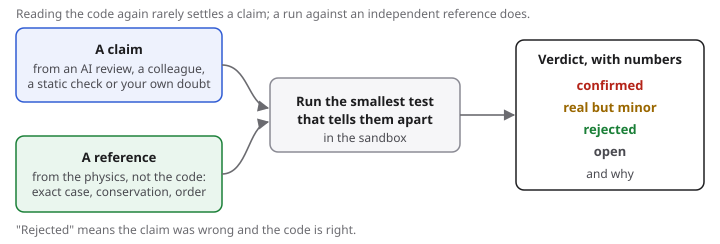
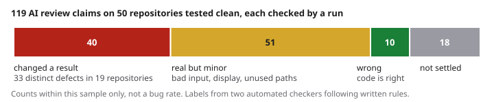

# physverify: confirm physics claims by running the code

[](https://github.com/rcgiri-physics/physverify/actions/workflows/ci.yml) [](https://pypi.org/project/physverify/) [](https://pypi.org/project/physverify/) [](https://doi.org/10.5281/zenodo.23534512) [](https://rcgiri-physics.github.io/physverify/)

**A suspected bug in simulation code is a claim. physverify turns it into a run against a reference written from the physics, and gives a verdict with the numbers.**

The claim can come from an AI code review, a colleague, a static check or your own doubt. Reading the code again rarely settles it; a run against an exact solution, a conservation law or a convergence order does. physverify supplies those checks for numerical ODE and PDE code (order of convergence, manufactured solutions, conservation, Runge-Kutta tables, exact references, a few Monte Carlo statistics), a sandbox for running code you do not trust, and plain-language verdicts. It needs only NumPy. Current release: 0.7.0 (v0.7.0); actively developed, contributions welcome.



## What confirming claims found on 100 repositories

Five AI reviewers (three Claude models, Qwen 3.8 Flash and GPT 5.6 Terra) reviewed 100 public physics repositories with one fixed prompt. Fifty had a defect reported earlier; fifty had been tested and found clean. On the clean fifty, 119 review claims were drawn and each was given a check run in the sandbox:



- **40 claims were real defects that change a result:** 33 distinct defects in 19 of the 50 "clean" repositories. 32 have been reported to their maintainers.
- **51 were real but minor** (invalid input, display, docstrings, code paths the repository never uses), **10 were wrong** and **18 could not be settled.**
- Nine of the ten wrong claims came from one model. Where a reading was recorded before the run (20 claims), the run changed 3 verdicts.
- Against the 67 defects reported earlier, the reviewers named 36 to 49; `physverify scan`, which reads code without running it, named 11.

So AI review finds many real defects, including ones earlier testing missed, but a claim is not a finding until something runs. The counts hold for this sample only and are not a bug rate for physics code. The labels come from two automated checkers following written rules, not from people. Tables: `scripts/study100.py` regenerates them from the per-claim file, released with the preprint ([doi:10.5281/zenodo.24224433](https://doi.org/10.5281/zenodo.24224433)).

## Try it

```bash
pip install physverify
physverify demo
```

The demo checks a correct solver (all checks pass), then the same solver with the damping 10% too large (all fail):


New to this? [Start here](https://rcgiri-physics.github.io/physverify/start-here/) takes about ten minutes and includes a prompt to paste if you use an AI coding assistant.

## Use it on your own code

- **Suspected bugs from a review (yours or an AI's):** write each claim down, pick a reference that does not come from the code, and run the smallest test that tells the two answers apart. [Checking an AI code review](https://rcgiri-physics.github.io/physverify/ai-review/) walks through it with examples.
- **An ODE solver:** `physverify init verify_solver.py --solver mysolver --order 4` writes a spec; fill in the equations (from the physics, not from your code) and run `physverify run verify_solver.py`.
- **Errors you already have:** `check_order(hs, errors, expected=2)` gives PASS, FAIL or INCONCLUSIVE with a reason.
- **A Runge-Kutta table:** `check_tableau(A, b, c, claimed=3)` from `physverify.butcher` checks order, stage order and stability from the coefficients alone.
- **Code you have not read yet:** `physverify scan PATH` reads the source, runs nothing, and flags a fixed set of patterns (Runge-Kutta tables below their stated order, grid spacings that do not match their grid, near-miss constants, removed NumPy/SciPy features, undefined names, unit tables with the wrong dimension). A clean scan means only that those patterns were not found. `scan` is kept working but no longer gets new rules; the work now goes into confirming claims.

Code from other people runs only in the [sandbox](https://github.com/rcgiri-physics/physverify/tree/main/sandbox) (no network, read-only repository).

## Run it in CI

A failed check fails the job, like a broken unit test ([CI guide](https://rcgiri-physics.github.io/physverify/ci/)):

```yaml
      - uses: rcgiri-physics/physverify@v0.7.0
        with:
          specs: tests/verify_*.py
```

[Getting started](https://rcgiri-physics.github.io/physverify/getting-started/) · [Recipes](https://rcgiri-physics.github.io/physverify/recipes/) · [What a PASS means](https://rcgiri-physics.github.io/physverify/assumptions/) · [Troubleshooting](https://rcgiri-physics.github.io/physverify/troubleshooting/) · [API](https://rcgiri-physics.github.io/physverify/api/)

## Other evidence

- **Seeded bugs:** of 37 bugs added one at a time to five small solvers, the checks flagged 35 (plain "compare with one answer" tests: 27), with no false alarms. The same person wrote the bugs and the checks, so this shows the tool works as designed, not how it does on other code. `python scripts/reproduce_all.py` regenerates the tables.
- **Earlier corpus testing (October 2026):** of the first 74 defects reported to authors, 14 were found by a physverify check as such, 11 by running the code at all, and the rest by the reference in each repository's test script or by reading; the [ledger](https://github.com/rcgiri-physics/physverify/blob/main/results/corpus/LEDGER.md) lists them by ID. Details: [results](https://rcgiri-physics.github.io/physverify/results/).

## Limits

Works best for ODEs; PDEs only in 1D so far. Your code needs a way to add a source term, or a small wrapper that can itself be wrong. A PASS means these checks found nothing wrong; it does not prove the simulation correct, and it is only as independent as the reference you wrote: see [What a PASS means](https://rcgiri-physics.github.io/physverify/assumptions/).

## Contributing, citing, licence

Help is welcome: a trial report on your own solver, seeded bugs written by someone other than the author, adapters, documentation. See [CONTRIBUTING.md](https://github.com/rcgiri-physics/physverify/blob/main/CONTRIBUTING.md), the [code of conduct](https://github.com/rcgiri-physics/physverify/blob/main/CODE_OF_CONDUCT.md), [SUPPORT.md](https://github.com/rcgiri-physics/physverify/blob/main/SUPPORT.md), [SECURITY.md](https://github.com/rcgiri-physics/physverify/blob/main/SECURITY.md) on running untrusted code, and [AGENTS.md](https://github.com/rcgiri-physics/physverify/blob/main/AGENTS.md) for AI assistants. To cite, use [doi:10.5281/zenodo.23534512](https://doi.org/10.5281/zenodo.23534512) or [CITATION.cff](https://github.com/rcgiri-physics/physverify/blob/main/CITATION.cff). Changes: [CHANGELOG.md](https://github.com/rcgiri-physics/physverify/blob/main/CHANGELOG.md); plans: [ROADMAP.md](https://github.com/rcgiri-physics/physverify/blob/main/ROADMAP.md). The methods are standard and other tools do parts of this, some better (NodePy for Runge-Kutta analysis); see [related work and credits](https://rcgiri-physics.github.io/physverify/related-work/). MIT licence, copyright (c) 2026 Ram Chandra Giri.

<!-- mcp-name: io.github.rcgiri-physics/physverify -->
