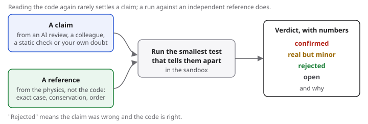

# Checking an AI code review

An AI reviewer asked to "look for bugs in the physics or numerics" of a simulation will usually return a list of suspicions. Some are real, some are not, and reading the code again rarely settles which.

In a study on 100 public physics repositories (November 2026), five AI reviewers (three Claude models, Qwen 3.8 Flash at low effort and GPT 5.6 Terra at the light setting) each reviewed every repository once with the same short prompt. Against 67 defects reported earlier, they named 36 to 49; `physverify scan` named 11. On the 50 repositories earlier testing had found clean, 119 claims rated high, medium or unrated were drawn and each was given a check run in the sandbox:

| Verdict | Claims |
|---|---|
| a real defect that changes a result | 40 (33 distinct defects, in 19 of the 50 repositories) |
| real but minor (invalid input, display, docstrings, code paths never used) | 51 |
| wrong: the code is right | 10 (9 from one model) |
| could not be settled | 18 |

Where a reading was recorded before the run (20 claims), the run changed 3 verdicts. 32 of the 33 defects have been reported to their maintainers. The counts describe this sample only and are not a bug rate; the labels come from two automated checkers following written rules, not from people. `scripts/study100.py` regenerates the tables from the per-claim file released with the preprint (in preparation).

physverify is the step after the review: each claim becomes a check that runs the code against a reference written from the physics.

## From claim to verdict

1. **Write the claim down precisely.** File, line, and what should happen instead, e.g. "`compute_power_spectrum` divides by W(k); the bias on P(k) is W(k)²".
2. **Choose a reference that does not come from the code.** An exact solution, a textbook identity, a paper's formula, or a second independent calculation. `physverify references` lists exact solutions. Say where it came from.
3. **Write the smallest test that can tell the two answers apart.** Pick inputs where the claim predicts a clearly different number (a factor, a sign, an order of convergence), and compute both. If no input separates them, the claim is not decidable this way: say so.
4. **Run it.** On code you do not trust, inside the [sandbox](https://github.com/rcgiri-physics/physverify/tree/main/sandbox). If only one function is needed, `physverify.loaders.extract_functions` loads it without importing the whole package.
5. **Record the verdict:** confirmed (with the numbers), rejected (with the numbers), or open. A fix that removes the difference is good supporting evidence.

## Examples

| claim | reference | result |
|---|---|---|
| FFTLog period taken as (N−1)Δ instead of NΔ | exact Hankel pair x e^{−x²/2} ↔ y e^{−y²/2} | error 3.8e-3 at N = 256, falling as 1/N; 2.5e-8 with NΔ: confirmed |
| `kx + ky % 2` meant `(kx + ky) % 2` in a spherical-to-cartesian table | the m = 0 column must reproduce the Legendre polynomial P_l(z) | exact for l ≤ 3, off by 0.12–0.66 for l = 4–6: confirmed |
| a dataclass field order makes import crash | run the import | it imports: rejected |

## Notes

- A claim confirmed by reading only is still a suspicion. Report it as such.
- Expect some confident claims to be wrong: in the study one model's high-rated claims included code that does not exist and an import crash that did not happen.
- Before telling a maintainer, follow the usual rules: show the numbers, say what was not tested, and keep it to what the run supports.
